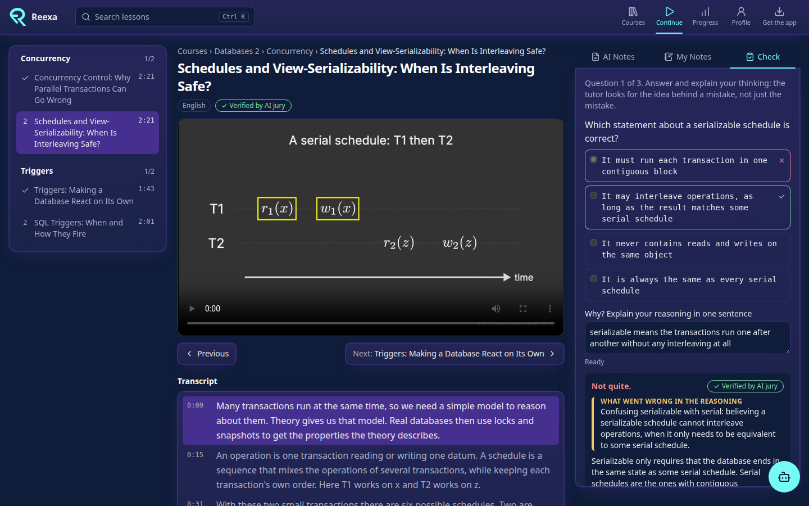
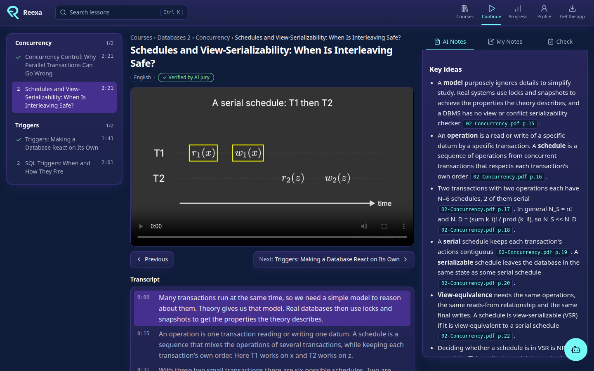
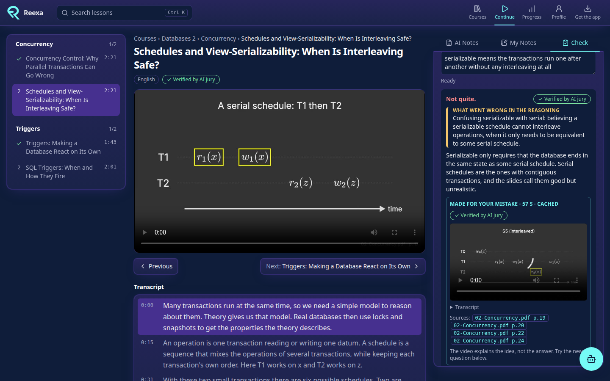
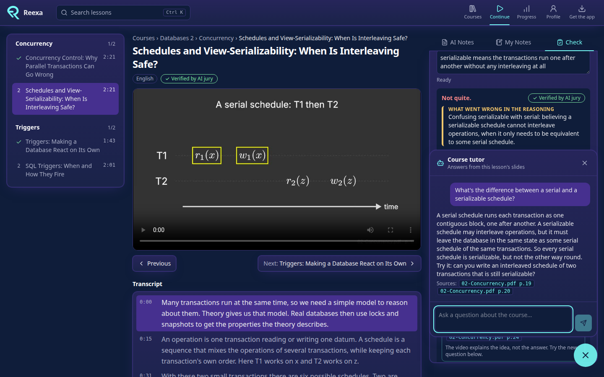
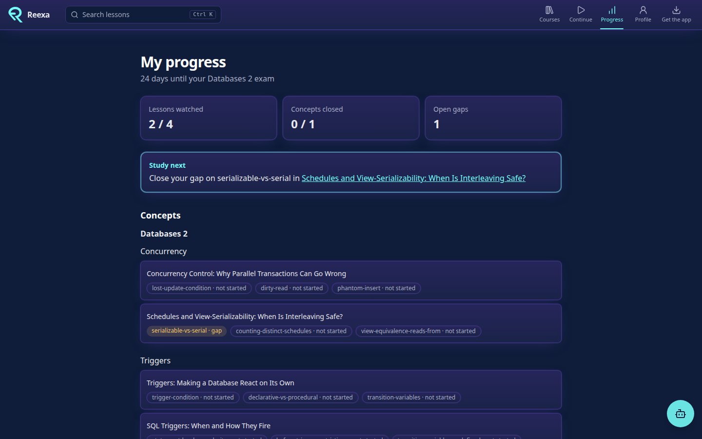
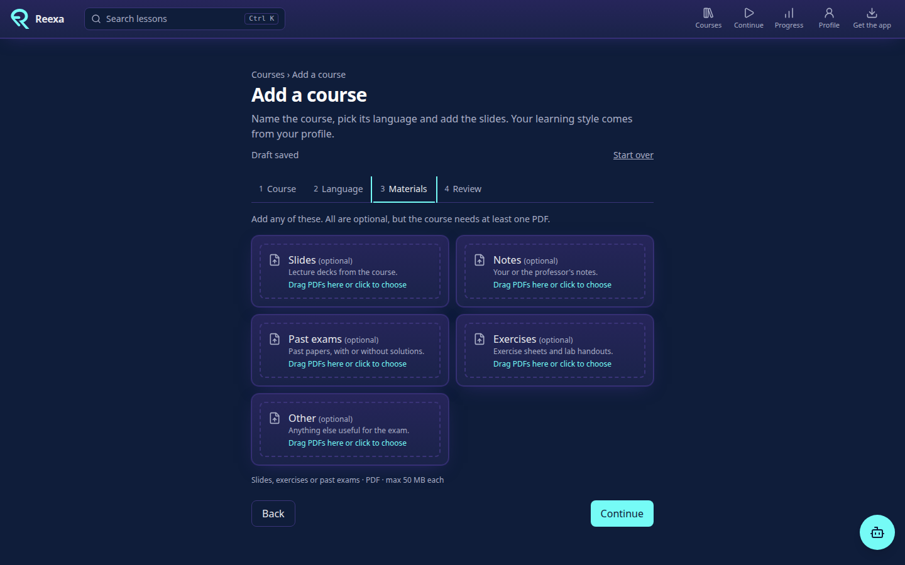
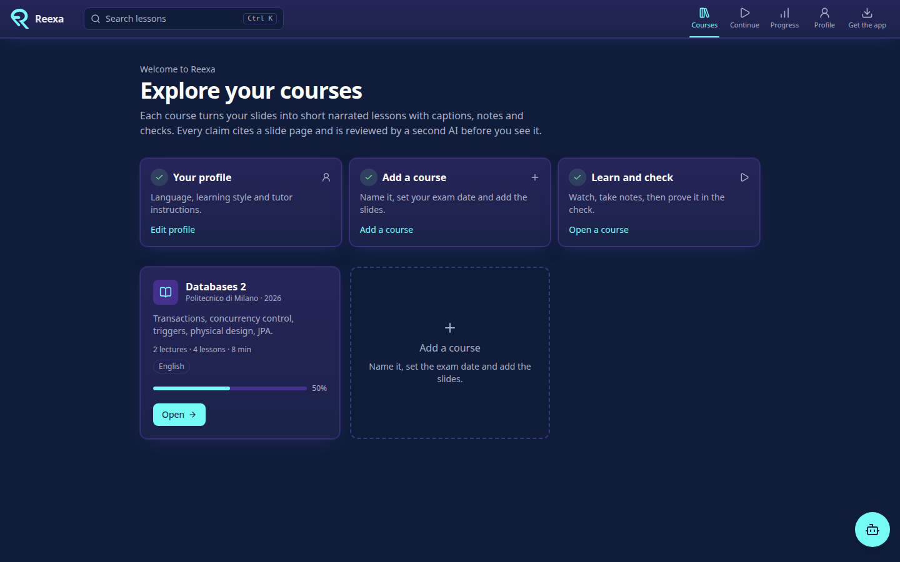
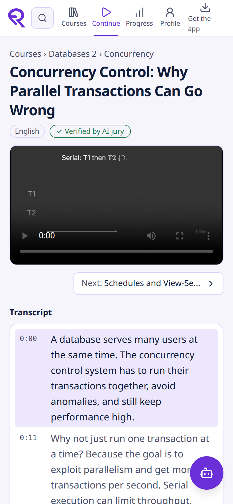

<div align="center">


# Reexa

**Find the idea behind the mistake.**

Your course slides become a personal playlist of narrated, captioned video lessons.
When you get a question wrong, Reexa finds the idea you misunderstood, makes you a one-minute video about exactly that idea, and asks a new question to prove you got it.

[**Live demo**](https://web-zeta-six-87.vercel.app) · [**Desktop app**](https://web-zeta-six-87.vercel.app/download) · [Pitch & deck notes](docs/PRESENTATION.md)

*Built in one day at the **Reply Student Tech Clash 2026, "AI on Campus"** (Politecnico di Milano team).*



</div>

---

## The problem

It's the night before your exam. You get an exercise wrong. The solution sheet tells you *that* you're wrong, not *why*. Re-reading the same slides rarely helps, and a chatbot hands you the answer, so the misunderstanding comes with you into the exam.

## What Reexa does

1. **Upload your course material:** slides, notes, past exams, exercises (drag and drop, all optional, at least one PDF).
2. **Watch your playlist:** each lecture becomes short narrated lessons with captions, a clickable transcript and AI notes, in your language, in the style of 3Blue1Brown animations.
3. **Check yourself:** pick an answer **and explain your reasoning**. Nothing is revealed before you try.
4. **Get a diagnosis:** Reexa names the specific idea that broke, cites the slide page, and offers a **1-minute video made for that mistake**.
5. **Prove it:** a new question on the same idea closes the gap; your progress page shows what's left.

| | |
|---|---|
|  |  |
| **Lesson player:** animated video, captions, transcript you can click, notes where every claim links to its slide page. | **Made for your mistake:** a short video on the misunderstood idea, reviewed by the AI jury, then a new question. |
|  |  |
| **Course tutor:** ask anything about the course; it answers only from your slides, cites pages and nudges you with a question instead of giving answers away. | **Progress:** exam countdown, lessons watched, concepts closed and the next gap to study. |
|  |  |
| **Add a course:** typed materials, exam date, level, lesson language and an optional teaching-tone prompt (security-checked). | **Your courses:** everything in one place, with progress per course. |

<p align="center"></p>

## Trust by design

AI study tools hallucinate, so Reexa is built against it:

- **Cited:** every lesson, note, quiz and diagnosis is built from the uploaded pages and links to the exact slide page.
- **Checked:** an independent **AI jury** reviews every generated item for faithfulness, correctness and answer leaks. Failures are regenerated once, then withheld and flagged. (One of the demo lessons was rejected by the jury and regenerated before any student saw it.)
- **Guarded:** free-text student instructions pass a prompt-injection guard (**Google Model Armor** when configured, local rules otherwise) and only ever act as style hints.
- **Honest:** it never reveals an answer before you try, and the targeted video explains the idea, not the solution.
- **Private:** notes and progress stay in your browser; your name is never sent to the AI.

## How it works

```
PDF ──► page-by-page text ──► outline ──► lesson script, notes & quiz ──► AI jury ──► voice-over + captions ──► ManimGL animation ──► playlist
                                            (Claude Sonnet)               (Claude Haiku)   (edge-tts, VTT)        (fixed visual templates)
```

| Part | Stack |
|---|---|
| Web app | Next.js 16 (App Router), React 19, Tailwind CSS v4, shadcn-style UI, deployed on Vercel |
| Video pipeline | Python, ManimGL (3Blue1Brown's library), edge-tts, ffmpeg, pdftotext |
| AI | OpenRouter (any OpenAI-compatible endpoint): Claude Sonnet writes, Claude Haiku judges; Ollama for local/offline mode |
| Safety | Google Model Armor / local prompt guard, AES-GCM sealed tokens so answers never reach the browser early |
| Auth | Firebase (Google sign-in) |
| Apps | Installable web app (PWA) · Electron desktop app (Windows, Linux) with an offline local-AI mode |
| i18n | 8 interface languages, 6 lesson languages |

Repository layout:

```
web/       Next.js app (pages, API routes, i18n dictionaries)
worker/    Python pipeline: PDF → lessons, targeted explanation videos
desktop/   Electron shell (online or local Ollama mode)
specs/     Spec Kit spec, plan and contracts
docs/      Pitch pack, hackathon brief, screenshots
```

## Run it locally

```bash
# 1. Web app
cd web && pnpm install
cp ../.env.example ../.env.local   # set OPENROUTER_API_KEY, or LLM_STUB=1 to run without AI
ln -s ../.env.local .env.local
pnpm dev                            # http://localhost:3000

# 2. Video pipeline (needs a conda env with ManimGL, LaTeX and ffmpeg)
conda create -n 3b1b python=3.12 && conda activate 3b1b
pip install -r worker/requirements.txt
python -m worker.pipeline path/to/lecture.pdf --max-sections 2

# 3. Desktop app
cd desktop && pnpm install && pnpm start      # or: pnpm local (Ollama)
```

> The sample course content in this public repo has the verbatim slide text removed. Citations, AI notes, videos and quizzes are generated material.

## Roadmap

- Download lectures for offline study, with update notices on new versions
- Native mobile apps
- Progress synced to your account
- "Sources differ" alerts when slides and notes disagree
- An opt-in professor view of the most common misconceptions

## Team

Abhishek Kishor · Alisha Fernandez · Deniz Akyüz · Sergio Rodrigo Fernandez Testa

*Built at the Reply Student Tech Clash 2026, "AI on Campus". Hackathon brief: [docs/HACKATHON.md](docs/HACKATHON.md).*
